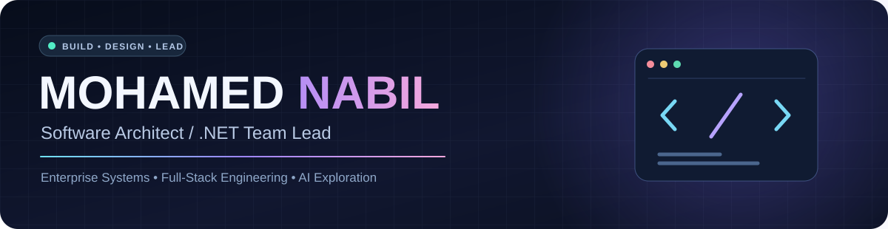

  

  
  
  
  

  

## 👋 About Me

I’m **Mohamed Nabil Mohamed**, a **Software Architect, .NET Team Lead, and Full-Stack Developer** with **14+ years of software development experience** building practical systems for real business operations.

I focus on transforming complex requirements into maintainable, production-ready software — with hands-on experience in **enterprise applications**, **legal practice management**, **point-of-sale systems**, **customer service platforms**, **APIs**, **database architecture**, and **technical leadership**.

- 🏗️ **Currently building:** Enterprise-grade applications and **NativeAI**, a local AI chatbot built from scratch using **C#**, **.NET 8**, and **TorchSharp**.
- 🧠 **Currently learning:** Deep learning, transformers, tokenization, attention, LLM architecture, model training, and advanced .NET practices.
- 🤝 **Open to collaborate on:** .NET products, SaaS platforms, enterprise systems, AI-enabled solutions, and valuable open-source work.
- 💬 **Ask me about:** C#, ASP.NET Core, ASP.NET MVC, SQL Server, REST APIs, system architecture, full-stack development, and software design.
- ⚡ **Fun fact:** I enjoy turning operational pain points into clean, scalable software — and I’m building my own AI model from scratch.

  

## 🧩 Core Expertise

<table>
<tr>
<td width="50%" valign="top">

### Architecture & Delivery
- Software Architecture
- Enterprise System Design
- Technical Team Leadership
- Requirements Analysis
- API & Service Integration
- Deployment & Production Readiness

</td>
<td width="50%" valign="top">

### Product & Engineering
- Full-Stack Development
- Database Design & Optimization
- Role & Permission Systems
- Dashboard & Admin Systems
- Process Automation
- AI Product Experimentation

</td>
</tr>
</table>

## 💻 Technology Stack

### Backend & Frameworks

### Frontend & UI

### Data, Tools & Platforms

  

## 🚀 Selected Projects

### ⚖️ Aljamaan — Law Firm Management System
A web-based legal operations system for case tracking, hearings, reminders, archiving, permissions, branches, clients, payments, and dashboard workflows.

**Highlights:** Case lifecycle management · session tracking · admin dashboards · permissions · branch/client workflows

**Tech:** C#, ASP.NET MVC, Angular, SQL Server, API, jQuery, Highcharts

---

### 🛒 POS System — Desktop Retail Platform
A point-of-sale and purchasing system designed for real operational environments, including touch and non-touch interfaces, permissions, task follow-up, and role-based dashboards.

**Highlights:** Retail workflows · desktop dashboards · employee task management · role permissions

**Tech:** C#, DevExpress, SQL Server

---

### 📞 Customer Complaints Web System
A complaint and evaluation platform with reporting tools to help businesses monitor customer issues, review feedback, and improve product/service quality.

**Highlights:** Complaint workflows · call/evaluation flows · reporting dashboards

**Tech:** C#, ASP.NET MVC, Angular, SQL Server, DevExpress

---

### 🤖 NativeAI — Local AI Chatbot from Scratch
An experimental AI product focused on training and evolving a local model using **C#**, **.NET 8**, and **TorchSharp**, with ongoing work around tokenization, attention, training loops, and practical AI tooling.

**Focus:** Building an independent AI experience with local memory, training workflows, and future file/image understanding.

**Tech:** C#, .NET 8, TorchSharp, SQL Server

  

## 📊 GitHub Analytics

  
  

  

## 🌍 Connect With Me

- 🌐 Website: **https://db-solutions.cloud/**
- 💼 LinkedIn: **https://www.linkedin.com/in/eng-mohammednabil**
- 📧 Email: **eng.mohamednabil@icloud.com**

  

<!-- GitHub Profile V3 by ChatGPT -->
